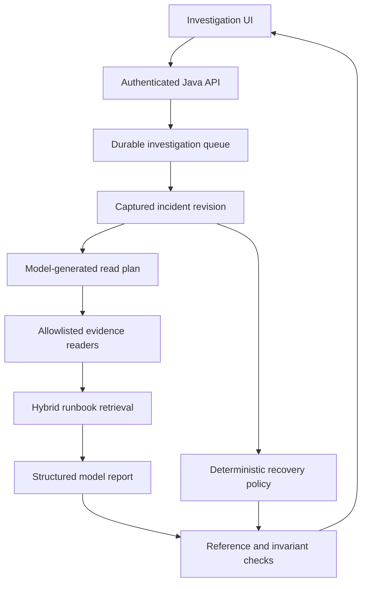
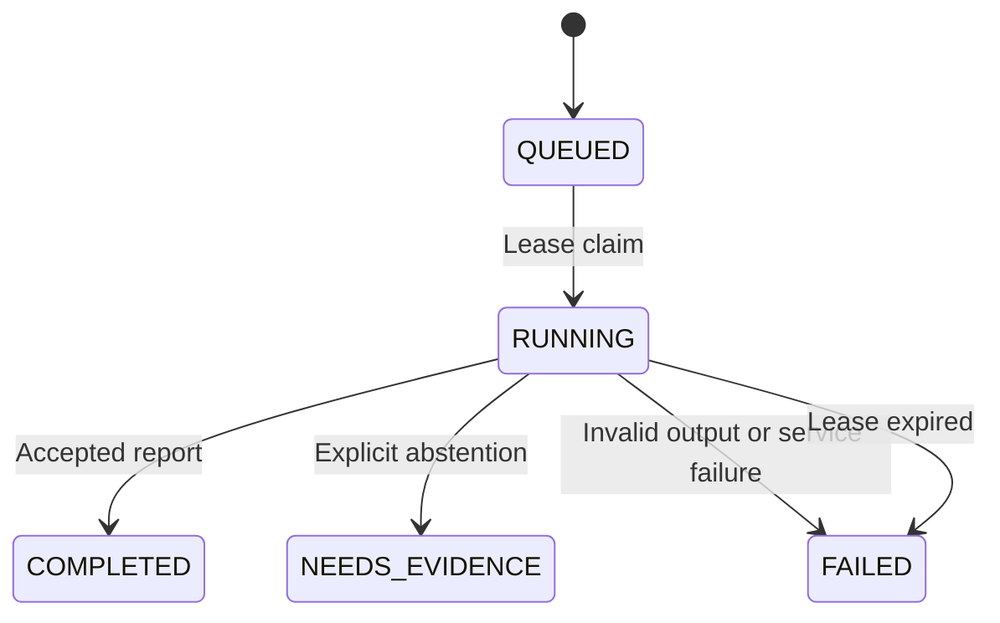

# Architecture and boundaries

TraceLens is an AI-assisted explanation service for backend incidents. It integrates an actual local LLM and embedding model through Ollama's HTTP API. Java owns tool execution, evidence capture, job state, retrieval, output verification, and recovery rules. It does not execute incident recovery actions.

## Data and job lifecycle

`POST /api/investigations` captures an incident's JSON snapshot and revision. A unique request key and fingerprint of incident, revision, and question make repeated submissions idempotent. Reusing a key for a different request returns 409. Updating an incident later does not rewrite the submitted snapshot.

The worker atomically claims a queued row using `FOR UPDATE SKIP LOCKED`, assigns a unique lease token, then performs model work outside the transaction. Only the matching unexpired token may publish a completed report. Each JVM allows one active investigation; PostgreSQL coordinates separate instances. A lease that expires while running becomes `FAILED / WORKER_INTERRUPTED`. No automatic model retry hides additional cost. The user can explicitly submit another request.

Completed investigations, their selected evidence, model usage, retrieval ranks, and trace are persisted in PostgreSQL. A rejected output does not become a canned replacement report. The API exposes the failure code. Completed JSON contains the captured, redacted evidence supplied to the model.

## Model orchestration

The first LLM call emits a schema-constrained tool plan with names from `get_event`, `get_attempts`, `get_ledger`, and `get_logs`, plus a runbook query. This is application-level structured planning, **not native model `tool_calls`**. Java validates the plan and invokes readers on the captured snapshot. The backend additionally requires all four evidence sources; the trace distinguishes `model-selected` from `required-evidence` reads.

The report call receives captured facts, evidence, retrieved runbooks, and an independent backend assessment. Its schema restricts classification codes to those compatible with captured invariants, missing-evidence descriptions to known capture gaps, and next-step advice to applicable identifiers. The validator repeats those checks rather than trusting the model or JSON grammar. One report repair is allowed; the total budget is three chat calls. The model writes the natural-language explanation and source references. It is not an unrestricted root-cause classifier.

Generation is non-streaming, temperature 0, seed 42, context 4096, planner output capped at 160 tokens and report output at 700 tokens. Defaults use a 120-second timeout per model request and a 600-second job lease. Different runtimes and hardware can still change output.

## Hybrid retrieval

The corpus contains twelve authored operational runbook chunks, including unrelated transfer and migration distractors. PostgreSQL stores English `TSVECTOR` documents and a GIN index for keyword search. Ollama `all-minilm` produces real vectors, persisted in PostgreSQL `double precision[]` arrays under document ID, model name, and content hash.

Java computes exact cosine similarity over the bounded corpus. It combines the first six lexical and semantic results using reciprocal-rank fusion:

`score(document) = 1 / (60 + lexical_rank) + 1 / (60 + semantic_rank)`

An absent list contributes zero. Ties sort by document ID. The top three become report evidence R1–R3. A changed content hash or configured model triggers re-embedding. This version caps the corpus at 1,000 chunks. It does not use pgvector, approximate nearest-neighbor search, or a distributed vector service.

## Recovery policy

| Captured condition | Backend assessment | Manual replay eligible |
| --- | --- | --- |
| Ledger unavailable or malformed | Request authoritative evidence | No |
| Event and ledger identity or amounts conflict | Investigate integrity | No |
| Matching ledger exists, completion missing | Reconcile status | No |
| Matching ledger exists, event succeeded | No recovery action | No |
| No ledger entry, retry still scheduled | Wait for worker | No |
| No ledger entry, expired processing lease | Recover through fenced worker | No |
| Dead-letter event, terminal condition active | Correct mapping | No |
| Dead-letter event, injected fault cleared, ledger empty | Operator may review a replay | Yes, advice only |

These are project-specific operational rules. A real service would require its own domain invariants, authoritative data guarantees, and action authorization. TraceLens has no endpoint that executes replay, updates a balance, deletes ledger entries, or runs arbitrary commands.

## Read-only project-one integration

`WebhookImporter` uses a server-configured URL and token. The only upstream request is `GET /api/events/{validatedEventId}`. Clients cannot provide an arbitrary destination. Redirects are disabled; time and body size are bounded. A successful import creates or increments a revision. A missing upstream ledger field remains `known=false`, distinct from a successful empty query.

## Data handling and deployment scope

The operator token is compared in constant time. POST bodies are capped at 16 KiB; upstream captures at 64 KiB; model responses at 1 MiB. Bearer tokens, common secret assignments, and email patterns are redacted in evidence before model calls. This is a targeted redactor, not a guarantee of complete PII removal. Imported evidence is also redacted before persistence. Only synthetic records are published in the demo.

The Compose application binds to localhost. Ollama and PostgreSQL have no published host ports. Model inference is local after weights are downloaded. Before wider use, add TLS, per-user authorization, per-user quotas and retention, sensitive-data controls, corpus access filters, observability, and a separate audited action workflow. This is a portfolio application with real infrastructure and measured behavior, not a claim of production incident-response certification.
